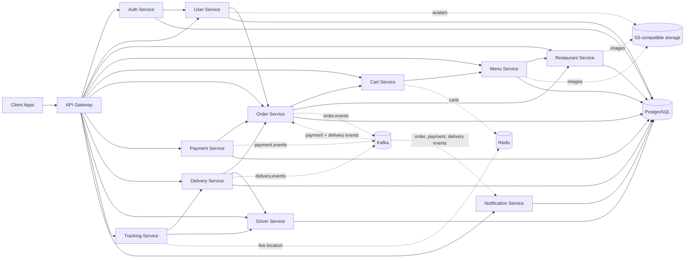

<p align="center">
  
</p>

<h3 align="center">A cloud-native, event-driven microservices platform for on-demand delivery</h3>

<p align="center">
  <a href="./LICENSE"></a>
  
  
  
  
  
  
  
</p>

<p align="center">
  
  
  <a href="https://github.com/Delivery-Plus0/delivery-plus/actions/workflows/ci.yml"></a>
  
  
</p>

<p align="center">
  <a href="#-the-delivery-plus-platform">Platform</a> ·
  <a href="#-project-status">Status</a> ·
  <a href="#-architecture">Architecture</a> ·
  <a href="#-tech-stack">Tech Stack</a> ·
  <a href="#-services">Services</a> ·
  <a href="#-getting-started">Getting Started</a> ·
  <a href="#-testing">Testing</a> ·
  <a href="#-contributing">Contributing</a> ·
  <a href="#contributors">Contributors</a> ·
  <a href="#-license">License</a>
</p>

---

##  Overview

**Delivery Plus** is a backend food-delivery platform built as independently deployable **microservices** that communicate over REST and **Kafka** events. Domain responsibilities are separated across auth, users, restaurants, menus, carts, orders, payments, drivers, deliveries, tracking, and notifications. PostgreSQL-backed services own relational data; cart and tracking use Redis; images live in S3-compatible object storage, uploaded directly by clients through presigned POST policies; the gateway owns no domain data.

For a one-page status of what is implemented, partial, or missing today, see [`.project-context/16-current-state.md`](./.project-context/16-current-state.md).

This is the **backend** of the Delivery Plus platform — no frontend/UI is included here by design. The customer, driver and restaurant apps live in companion repositories (below) and, like any third-party client, talk to the platform only through the **API Gateway**.

##  The Delivery Plus platform

Delivery Plus connects three roles around one order: a **customer** orders from a **restaurant**, the restaurant prepares it, the platform dispatches a **driver**, and everyone follows the same order and delivery state in real time.

```text
Delivery Plus  (github.com/Delivery-Plus0)
│
├── delivery-plus                  Backend platform (this repository)
│   └── 12 NestJS services behind one API Gateway · Kafka events · PostgreSQL · Redis · S3
│
├── delivery-plus-customer-app     Customer app (Expo / React Native: Android, iOS, web)
│   └── browse · cart · checkout · order status · live driver tracking · alerts
│
├── delivery-plus-driver-app       Driver app (Expo / React Native)
│   └── online/offline · automatic job assignment · pickup → delivered · location sharing
│
└── delivery-plus-restaurant-app   Restaurant app (Expo / React Native, web-first)
    └── incoming orders · kitchen workflow (preparing → ready for pickup) · availability
```

| Repository | Responsibility | Visibility |
|---|---|---|
| [`delivery-plus`](https://github.com/Delivery-Plus0/delivery-plus) | Business rules, data, events, auth and the public API. The single source of truth for order, payment, delivery and tracking state; also hosts the project-wide issue tracker and roadmap milestones. | Public |
| [`delivery-plus-customer-app`](https://github.com/Delivery-Plus0/delivery-plus-customer-app) | The customer experience. | Public |
| [`delivery-plus-driver-app`](https://github.com/Delivery-Plus0/delivery-plus-driver-app) | The driver experience. | Public |
| [`delivery-plus-restaurant-app`](https://github.com/Delivery-Plus0/delivery-plus-restaurant-app) | The restaurant experience. | Public |
| `delivery-plus-admin-app` | The staff console (operations, support, onboarding, finance). Built from Production 3 on. | Private |

The customer, driver and restaurant apps share one UI kit, kept byte-identical against [`clients/kit-manifest.json`](./clients/kit-manifest.json) in this repository. It covers dialogs, sheets, toasts, sessions, the email-code screen, and Arabic/English with RTL. The admin app joins it in Production 3.

How they interact: every app calls the API Gateway over HTTPS with a JWT whose role (`CUSTOMER`, `DRIVER`, `RESTAURANT_OWNER`) decides what it may do; the apps never talk to each other or to individual services. State changes flow through the backend (for example: restaurant marks an order ready → `order.ready_for_pickup` → automatic dispatch assigns an online driver → the driver app sees the job → the customer app shows the driver and the live map). Each app's E2E suite runs against this repository's isolated E2E stack, and the customer app's business flow drives all three apps in one browser.

##  Project status

Honest status, tracked in this repository's [milestones](https://github.com/Delivery-Plus0/delivery-plus/milestones) and the [production roadmap](./docs/roadmap/production.md). Details per area: [`.project-context/16-current-state.md`](./.project-context/16-current-state.md).

**Implemented**
- **Accounts:**
  - customer, driver, restaurant owner and staff (admin) roles;
  - 15-minute access tokens with rotating refresh tokens, where reusing an old refresh token ends the session;
  - sign-out everywhere, account suspension and staff permissions;
  - services call each other as a separate `SYSTEM` identity;
  - email verification by a 6-digit code (Amazon SES);
  - phone verification by SMS code, and password change and reset by SMS code;
  - per-client rate limits behind proxies (`TRUSTED_PROXY_HOPS`).
- **Catalogue and ordering:**
  - restaurants, menus with categories, images, availability and archiving;
  - an atomic Redis cart;
  - checkout with a server-side delivery fee (EGP);
  - idempotent order creation, cancellation and refund rules, reject-with-reason for restaurants.
- **Events:** order and delivery events go through a transactional outbox; Kafka consumers deduplicate, retry, and park failures in dead-letter topics.
- **Payments:** **simulated** only, with no real card provider yet. The simulator refuses to run in production.
- **Delivery:**
  - automatic dispatch to verified drivers only;
  - the delivery lifecycle (assigned → picked up → in transit → delivered);
  - a driver earnings ledger and wallet;
  - customers rate drivers.
- **Live tracking:** the driver's location is bound to the active delivery, with server-sent events and a polling fallback, and a customer-safe driver card.
- **Notifications:** in-app, localized by message key (Arabic and English). No push notifications yet.
- **Media:** S3-compatible uploads through presigned POST.

**In progress:** the [production roadmap](./docs/roadmap/production.md), 10 milestones from a hotfix to a paid pilot.
- **Production 0** (hotfix) is done.
- **Production 1** (accounts and sessions) is done in this repository. The apps' password change and reset screens are the last open part.
- **Production 2** (onboarding and service area) has started with fair, longest-idle dispatch (#210).

**Planned / not built yet** (see the roadmap):
- Driver and restaurant onboarding, delivery areas (M2).
- The admin console (M3–M4).
- Staging, hardening and the NestJS upgrade (M5).
- Real payments, settlements and payouts (M6).
- Real SMS, push notifications, background location (M7).
- ETA estimation (the contract exists, no estimator).

##  Architecture



Every service is self-contained and shares a common foundation through the internal `shared` library. The shared package provides enums, transition helpers, Kafka/Redis helpers, S3 media storage, internal service authentication, JWT and role guards, logging, and common NestJS utilities. Redis is also used for caching, rate limits, and internal-auth nonces, which the diagram omits for readability. Kafka consumers deduplicate events per consumer group in Redis, retry a failing handler three times, then park the message in a `<topic>.dlq` dead-letter topic that `npm run kafka:dlq` can list and replay; events are keyed by `orderId`. Order and delivery events go through a transactional outbox (written in the same database transaction as the state change, then relayed to Kafka); payment-service still publishes directly, at most once per payment status.

##  Tech Stack

| Layer | Technology |
|---|---|
| Runtime | Node.js 22 LTS |
| Language | TypeScript 5 |
| Framework | NestJS 10 |
| Database | PostgreSQL 16 |
| Cache / Real-time state | Redis 7 |
| Messaging / Events | Apache Kafka |
| Media storage | S3-compatible object storage (SeaweedFS in local dev/test) |
| Containerization | Docker & Docker Compose |
| Testing | Jest (unit + e2e) |
| Shared internals | Custom `shared` package (events, guards, filters, utils) |

##  Services

| Service | Responsibility |
|---|---|
| `api-gateway` | Single entry point and routing; blocks internal routes and refuses service tokens from outside; forwards the client IP for rate limits |
| `auth-service` | Credentials, access and refresh tokens, sessions, account status, staff permissions, email verification, password change and reset |
| `user-service` | User profiles, avatars, Egyptian phone numbers and SMS codes |
| `restaurant-service` | Restaurant records, status and images |
| `menu-service` | Menu categories and items, availability, images, archiving |
| `cart-service` | Shopping cart (Redis-backed, compare-and-set writes) |
| `order-service` | Order lifecycle, delivery fee, cancellation rules, outbox events |
| `payment-service` | Payments and refunds (simulated provider) |
| `driver-service` | Driver profiles, verification gate, availability and the dispatch queue |
| `delivery-service` | Automatic dispatch, delivery lifecycle, driver earnings ledger, ratings |
| `tracking-service` | Live location tracking (Redis-backed, server-sent events) |
| `notification-service` | In-app notifications for every order stage |

Every service, including the API Gateway, exposes a `/health` route used by Compose healthchecks. These are liveness checks; they do not prove that Kafka, Redis, or downstream services are reachable. Services generally follow `controllers → services → repositories/entities`, with variations by service.

##  Getting Started

### Prerequisites

- **Node.js 22** (22.15 or newer). CI and the Docker images use Node 22.
- **Docker** with Compose v2 (Docker Desktop on Windows/macOS). Give Docker at least **8 GB of memory**: the stack runs 12 services plus PostgreSQL, Redis, Kafka and object storage.
- **Git.** On Windows, keep line endings as committed (`git config core.autocrlf input` or `false`): workflow files must stay LF.

### Run the backend locally

```bash
# 1. Clone and install
git clone https://github.com/Delivery-Plus0/delivery-plus.git
cd delivery-plus
npm ci

# 2. Start the development stack: infrastructure + all services. --wait returns once every
#    healthcheck passes; the first build takes several minutes.
docker compose -f docker-compose.base.yml -f docker-compose.dev.yml up -d --build --wait --wait-timeout 300

# 3. Check it is up
curl http://localhost:3000/health

# 4. Create sample data through the API Gateway, then run the critical-path check
npm run seed
npm run e2e
```

No `.env` file is needed for the development stack: `docker-compose.dev.yml` has safe local defaults. Copy [`.env.example`](./.env.example) to `.env` only to override them. Never commit `.env`.

**What runs where (development stack)**

| What | Address |
| --- | --- |
| API Gateway (the only entry point for clients) | `http://localhost:3000` |
| Aggregated API docs (Swagger UI) | `http://localhost:3000/docs` |
| Public OpenAPI contract (for Apidog/Postman) | [`docs/openapi/delivery-plus-public.json`](./docs/openapi/delivery-plus-public.json) |
| Object storage (S3 API, SeaweedFS) | `http://localhost:9000` |
| Kafka (for host tools) / Kafka UI | `localhost:9092` / `http://localhost:8085` |

The services, PostgreSQL and Redis aren't published to the host; everything goes through the gateway, as for real clients.

**Accounts you can sign in with**

| Account | Created by | Email / password |
| --- | --- | --- |
| Customer, restaurant owner, driver | `npm run seed` | `customer@example.com`, `owner@example.com`, `driver@example.com` / `password123` |
| Demo customer with orders in every state | `npm run seed:demo` | `demo.customer@example.com` / `password123` |
| Staff admin (all permissions) | the stack itself, at startup | `qa.admin@delivery-plus.test` / `Qa-Only-Admin-Passw0rd!` |

These are local test accounts only. On the development stack, new drivers are verified automatically (`DRIVER_AUTO_VERIFY`) and verification emails are kept in Redis instead of being sent (`EMAIL_PROVIDER=test`). SMS is disabled, so phone codes and password reset answer `503` here; use the E2E stack below to try them.

**Stop or reset**

```bash
docker compose -f docker-compose.base.yml -f docker-compose.dev.yml down       # stop, keep the data
docker compose -f docker-compose.base.yml -f docker-compose.dev.yml down -v    # stop and delete the data
```

### The E2E stack (what the apps' UI tests use)

An isolated copy with deterministic data, on different ports (gateway `:3100`, storage `:9100`), so it can run next to the development stack. It enables the test SMS and email senders, so every flow can be exercised.

```bash
npm run e2e:start       # build, start and seed (writes e2e-seed-manifest.json)
npm run e2e:env:reset   # wipe and start again
npm run e2e:env:down    # stop and delete its volumes
```

Details, test accounts and switches such as `JWT_EXPIRES_IN=60s` and `EMAIL_VERIFICATION_REQUIRED=true`: [`docs/e2e.md`](./docs/e2e.md).

### Run an app against your backend

Clone [`delivery-plus-customer-app`](https://github.com/Delivery-Plus0/delivery-plus-customer-app), [`delivery-plus-driver-app`](https://github.com/Delivery-Plus0/delivery-plus-driver-app) or [`delivery-plus-restaurant-app`](https://github.com/Delivery-Plus0/delivery-plus-restaurant-app). Each has a `.env.example` with `EXPO_PUBLIC_API_BASE_URL=http://localhost:3000`. Use `http://10.0.2.2:3000` from an Android emulator. Then `npm ci` and `npx expo start`, and sign in with a seeded account. See each app's README.

### Troubleshooting

- **A service stays unhealthy:** run `docker compose -f docker-compose.base.yml -f docker-compose.dev.yml logs <service>`. The usual causes are too little Docker memory, or a port already in use (3000, 9000, 9092, 8085).
- **Out of memory or `npm ci` crashing during the first build:** build the images one at a time (`docker compose -f docker-compose.base.yml -f docker-compose.dev.yml build <service>` for each), then run step 2 again.
- **`npm run seed` fails with ECONNREFUSED:** the stack isn't healthy yet; wait for step 2's `--wait` to finish.
- **The production-like root `docker-compose.yml`** needs real secrets (`JWT_SECRET`, `SYSTEM_JWT_SECRET`, …) and refuses to start without them. For development, use the base + dev overlays above.

### Validate the other Compose layouts

```bash
# deterministic test layout
docker compose -f docker-compose.base.yml -f docker-compose.test.yml config --quiet

# production-like validation (requires secrets explicitly)
# These values are for Compose configuration validation only and must never be used for deployment.
export POSTGRES_USER="compose_validation_user"
export POSTGRES_PASSWORD="compose_validation_only_7f3c2b"
export POSTGRES_USER_URLENCODED="compose_validation_user"
export POSTGRES_PASSWORD_URLENCODED="compose_validation_only_7f3c2b"
export JWT_SECRET="compose_validation_only_jwt_9a41d8"
docker compose -f docker-compose.base.yml -f docker-compose.prod.yml config --quiet
```

```powershell
# PowerShell equivalent
$env:POSTGRES_USER="compose_validation_user"
$env:POSTGRES_PASSWORD="compose_validation_only_7f3c2b"
$env:POSTGRES_USER_URLENCODED="compose_validation_user"
$env:POSTGRES_PASSWORD_URLENCODED="compose_validation_only_7f3c2b"
$env:JWT_SECRET="compose_validation_only_jwt_9a41d8"
docker compose -f docker-compose.base.yml -f docker-compose.prod.yml config --quiet
```

### API documentation

The API Gateway aggregates every service's Swagger docs at `http://localhost:3000/docs`. Each service also serves its own at `/docs` on its port when you run it outside Compose. The public contract the apps use is generated into [`docs/openapi/delivery-plus-public.json`](./docs/openapi/delivery-plus-public.json) (`npm run openapi:generate`, checked by `npm run openapi:validate`).

See [`docs/deployment.md`](./docs/deployment.md) for the Compose variants, ports, and environment configuration. `npm run seed` bootstraps the sample environment through the API Gateway only. It is safe to rerun: existing accounts and catalog records are reused, while each run creates a new order/payment/delivery scenario. `npm run e2e` assumes the seed has completed successfully. For manual testing of the customer app, `npm run seed:demo` adds a richer catalog (6 restaurants across OPEN/BUSY/CLOSED, categorized menus with sold-out items, cover and avatar images) and a demo customer (`demo.customer@example.com` / `password123`) with a profile, a filled cart, notifications, and orders in delivered, cancelled, failed-payment, preparing, and on-the-way states. It is also rerunnable and does not interfere with `npm run seed` / `npm run e2e`.

##  Testing

```bash
# unit tests for a given service
npm run test --workspace=services/order-service

# complete repository validation used by CI
npm run verify

# API-level local bootstrap and critical-path validation
npm run seed
npm run e2e
```

`npm run verify` runs every workspace's lint, unit tests and build. Run it before every pull request.

**CI on every pull request:**

| Workflow | What it checks |
| --- | --- |
| **CI** / **PR Quality Gate** | Lint, build and unit tests of every workspace; Compose validation |
| **Integration** | Starts the full stack, seeds it, and runs the critical-path workflow (`npm run e2e`) |
| **Migration Verification** | Runs every service's migrations against PostgreSQL, plus the database integration tests |
| **Docker Build** | Builds every service image and scans it with Trivy |
| **Security** | CodeQL, `npm audit` (blocking on critical), Trivy filesystem and secret scan |

The customer, driver and restaurant repositories run their own Maestro UI suites against this repository's E2E stack, on every pull request and nightly.

##  Documentation

- [`docs/roadmap/production.md`](./docs/roadmap/production.md): the production roadmap, rules for every issue, and owner decisions
- [`.project-context/`](./.project-context/00-INDEX.md): the project's knowledge base. Start with `00-INDEX.md`, then `16-current-state.md`.
- [`docs/architecture.md`](./docs/architecture.md): a deep dive into service boundaries and event flows
- [`docs/deployment.md`](./docs/deployment.md): environment variables, ports, deployment guide
- [`docs/services.md`](./docs/services.md): the per-service API reference
- [`docs/e2e.md`](./docs/e2e.md): the isolated E2E stack and its test data
- [`docs/runbooks/`](./docs/runbooks/README.md): operational guides, such as the first admin and Amazon SES email
- [`docs/books/`](./docs/books/README.md): an engineering library built on this codebase

### Related repositories

- [Delivery Plus Customer App](https://github.com/Delivery-Plus0/delivery-plus-customer-app) · [Driver App](https://github.com/Delivery-Plus0/delivery-plus-driver-app) · [Restaurant App](https://github.com/Delivery-Plus0/delivery-plus-restaurant-app)

##  Contributing

Contributions are what make open source great. Please read [`CONTRIBUTING.md`](./CONTRIBUTING.md) and our [`CODE_OF_CONDUCT.md`](./CODE_OF_CONDUCT.md) before opening a PR.

1. **Pick an issue** from the lowest open [milestone](https://github.com/Delivery-Plus0/delivery-plus/milestones) whose **Depends on** issues are closed. Comment on it to claim it, and wait to be assigned. If it says **decision** and no comment records one, ask first.
2. **Fork the repo** and branch from `dev`: `feat/<short-name>` or `fix/<short-name>`.
3. **One issue per pull request.** Keep unrelated fixes for their own PR.
4. **Add a test for every acceptance criterion.** Run `npm run verify`, and the E2E stack for service behaviour.
5. **Update the docs in the same PR:** the OpenAPI spec, `docs/services/*.md` and `.project-context/16-current-state.md`.
6. **Open the PR against `dev`** with `Closes #N` and a Conventional title (`feat(auth): …`, `fix(dispatch): …`), and fill in the template.
7. **Reply to every review comment**, push the fixes, then re-request a review. Only a merged PR with all checks green counts as done.

Found a security issue? Please follow the process in [`SECURITY.md`](./SECURITY.md) instead of opening a public issue.

### Contributors

Thanks to everyone who has contributed to Delivery Plus. The graph updates itself as new contributions are merged.

<a href="https://github.com/Delivery-Plus0/delivery-plus/graphs/contributors">
  
</a>

See the [contribution activity](https://github.com/Delivery-Plus0/delivery-plus/graphs/contributors) and the [commit history](https://github.com/Delivery-Plus0/delivery-plus/commits/dev) for each contributor's share.

##  License

Distributed under the **MIT License**. See [`LICENSE`](./LICENSE) for details.

---

<p align="center">
  
  Made by the Delivery Plus team
</p>
